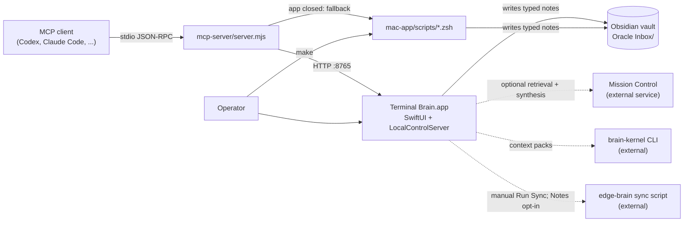

# Terminal Brain

**A native macOS control surface that gives agents local-first memory over MCP. It reads from an Obsidian vault, keeps Apple Notes and Drafts behind explicit opt-in, and sends every agent write to a reviewable inbox.**

[](https://github.com/mejohnc-ft/Franklin-Brain/actions/workflows/ci.yml)
&nbsp;Swift / SwiftUI · Node MCP server · macOS 14+ · Project page: [mejohnc.org/projects/terminalbrain](https://mejohnc.org/projects/terminalbrain/)

## Why it exists

Coding agents such as Codex and Claude Code do better work when they can see what you already know: open loops, earlier decisions, recent shipped work. The obvious way to give them that is to connect them straight to personal data sources, and that approach has problems. Background bridges trigger macOS permission prompts under `node`. Agent writes land wherever the agent chooses. Nothing tells you which memory is stale.

Terminal Brain sits between your agents and your notes:

- **One trusted app owns access.** Apple Events permissions belong to the `Terminal Brain.app` bundle, not to a stray Node process. At startup the app never reads Apple Notes.
- **Agents talk to it over MCP.** The MCP server is a thin proxy. It does not touch Notes, Drafts, or the vault directly.
- **Writes are governed.** Everything an agent commits lands as a new, typed Markdown note in an `Oracle Inbox` folder inside your vault, where a human triages it.
- **It never steals focus.** No command, script, or MCP tool launches or foregrounds the app, and CI enforces this.

## Features

- **Native macOS app** (SwiftUI, AppKit, AppIntents): a sidebar workflow (`Use Now`, `Work Block`, `Oracle`, `Review`, `Ideas`, `Start Work`), a command palette, a menu-bar extra, App Shortcuts, and a Settings window. The sidebar starts in Simple operator navigation mode, and `Use Now` opens on an inline *Ask, Decide, Remember* panel.
- **Local control API**: 67 HTTP routes on port `8765`, all listed in [`mac-app/expected-api-routes.json`](mac-app/expected-api-routes.json).
- **MCP server**: 83 tools over stdio JSON-RPC, with no npm dependencies. The contract is [`mcp-server/expected-tools.json`](mcp-server/expected-tools.json).
- **Closed-app fallbacks**: capture, ask, commit, outcome, review, and status all work when the app is not running. They fall back to local scripts that read or write the workspace directly.
- **Oracle**: ask a question and get a deterministic local answer built from current signals. If an optional Mission Control service is reachable, the answer is augmented with retrieval and synthesis from that service. You can commit the answer back to the vault.
- **Review queue**: committed notes carry a `reviewStatus` (`new`, `accepted`, `linked`, `delegated`, or `dismissed`) that you can change from the app, the CLI, or MCP.
- **Proactive briefing**: a source freshness registry, ranked action cards, and a daily brief built from vault, review, agent-history, and repo state.
- **Derived agent memory**: `make refresh-memory` summarizes recent Codex and Claude sessions into metadata only (project, goal and outcome hints, touched paths, counts). Raw transcript bodies are not stored.
- **Agent handoff**: single-file handoffs, bounded agent prompts with acceptance criteria, and context packs built with the brain-kernel CLI.
- **Operator diagnostics**: doctor, audit, process map, a non-destructive cleanup plan, and a support bundle. These cover repo, CI, launchctl, API, and MCP state.

## Architecture



| Path | Contents |
| --- | --- |
| `mac-app/Sources/TerminalBrain/` | The SwiftUI app, including `LocalControlServer.swift` (the HTTP API) and `BrainStatusModel.swift` (state and source health) |
| `mac-app/scripts/` | zsh entry points behind every `make` target, plus the verification and guard scripts |
| `mcp-server/` | The MCP proxy (`server.mjs`) and its tool-contract checker |
| `.github/workflows/ci.yml` | Runs the static verifier on `macos-15` |

## MCP tools

All 83 tools are prefixed `terminal_brain_`; for example, the full names of the last two tools in the table are `terminal_brain_value_proof_markdown` and `terminal_brain_visual_review_plan_markdown`. Grouped by purpose:

| Group | Tools |
| --- | --- |
| Orientation & readiness | `runtime_status`, `status`, `now`, `now_markdown`, `what_now_markdown`, `use_now_markdown`, `check_in_markdown`, `first_minute_markdown`, `next_markdown`, `start_here_markdown`, `doctor_markdown`, `audit_markdown`, `process_map_markdown`, `cleanup_plan_markdown`, `support_bundle_markdown`, `setup`, `permissions` |
| Governed writeback | `capture_idea`, `oracle_commit`, `commit_outcome`, `oracle_ask_commit`, `oracle_review_status`, `memory_promote`, `recent_work_promote` |
| Oracle & review | `oracle_ask`, `oracle_brief`, `oracle_brief_markdown`, `oracle_digest`, `oracle_digest_markdown`, `oracle_items`, `oracle_commits`, `review_queue_markdown`, `bubble_up_markdown`, `work_block_markdown` |
| Focus, ideas, blindspots | `focus`, `focus_ask`, `focus_ask_commit`, `ideas`, `ideas_markdown`, `idea_ask`, `idea_ask_commit`, `blindspots`, `blindspots_markdown`, `blindspot_ask`, `blindspot_ask_commit`, `blindspot_action`, `radar`, `radar_triage`, `today`, `today_markdown` |
| Memory & sources | `freshness_markdown`, `action_cards_markdown`, `daily_brief_markdown`, `refresh_memory_markdown`, `meeting_records_markdown`, `memory_brief_markdown`, `sources`, `sources_markdown`, `briefing`, `sync` |
| Agent handoff | `snapshot`, `snapshot_markdown`, `handoff_markdown`, `agent_prompt_markdown`, `latest_context_pack`, `latest_context_pack_markdown`, `start_work`, `projects`, `projects_markdown`, `operator_brief`, `operator_brief_markdown`, `operator_deck`, `operator_deck_markdown`, `operator_deck_action`, `value_brief`, `value_brief_markdown` |
| Self-evaluation | `value_now_markdown`, `value_proof_markdown`, `demo_markdown`, `playbook_markdown`, `value_audit_markdown`, `completion_audit_markdown`, `visual_review_plan_markdown` |

## Quick start

Requirements: macOS 14+ on Apple Silicon, Xcode Command Line Tools (`swiftc`), Node 18+, and Ruby, which the helper scripts use. The GitHub CLI `gh` is optional and is only used for CI status.

```zsh
git clone https://github.com/mejohnc-ft/Franklin-Brain.git && cd Franklin-Brain
make verify      # static QA + app build; never launches the app
make install     # builds and copies to ~/Applications/Terminal Brain.app (does not launch it)
make demo        # seeded walkthrough in a temporary workspace; your real vault is untouched

export TERMINAL_BRAIN_WORKSPACE="$HOME/path/to/your/vault"
make start       # one next move, plus the capture, ask, and outcome commands
```

Open the app yourself from `~/Applications` when you want the UI. For opt-in iPhone capture through a synced file-drop (without exposing the unauthenticated local API), see [iPhone contributor guide](docs/iphone-contributor.md). To register the MCP server with an agent:

```json
{
  "command": "node",
  "args": ["/absolute/path/to/Franklin-Brain/mcp-server/server.mjs"],
  "env": { "TERMINAL_BRAIN_API": "http://127.0.0.1:8765" }
}
```

### Configuration

Settings are read from the native Settings window. Environment variables take precedence over saved values.

| Setting | Environment variable |
| --- | --- |
| Workspace / vault path | `TERMINAL_BRAIN_WORKSPACE` |
| Mission Control URL (default `http://127.0.0.1:8080`) | `TERMINAL_BRAIN_MISSION_URL` |
| Mission Control SSH host | `TERMINAL_BRAIN_MISSION_SSH_HOST` |
| brain-kernel CLI path | `TERMINAL_BRAIN_CLI` |
| Sync script path / log | `TERMINAL_BRAIN_SYNC_SCRIPT`, `TERMINAL_BRAIN_SYNC_LOG` |

## Common commands

| Command | What it does |
| --- | --- |
| `make start` | The safest first command: one executable move, plus exact ask, capture, and outcome commands |
| `make idea IDEA="..." PROJECT="..."` | Capture a thought into the Oracle Inbox (works with the app closed) |
| `make ask QUERY="..."` | Ask the Oracle. `make ask-commit` also writes the answer to the inbox |
| `make review` / `make review-status ID=... STATUS=accepted` | List and triage the review queue |
| `make outcome TITLE=... OUTCOME=... PROJECT=... NEXT=...` | Record a structured outcome as an accepted note |
| `make daily-brief` | Freshness check, ranked actions, and an Oracle answer for the start of the day |
| `make doctor` | Readiness audit: repo, CI, install freshness, MCP contract, agent configs, and API |
| `make verify` | The full static verifier, which is what CI runs |

Other useful entry points include `make use-now`, `make first-minute`, `make check-in`, `make work-block`, `make bubble-up`, `make oracle-brief`, `make agent-prompt`, `make what-now`, `make processes`, `make support-bundle`, `make playbook`, `make value-audit`, `make completion-audit`, and `make design-audit`. The full list of more than 60 targets is in **[docs/commands.md](docs/commands.md)**. For the day-to-day loop, see **[START-HERE.md](START-HERE.md)**. Agent contributors should read **[AGENTS.md](AGENTS.md)** first.

## How writeback is governed

- **One destination.** Oracle commits, outcomes, captured ideas, and promoted memory are all written as new timestamped Markdown files under `<workspace>/Oracle Inbox/`, through either the app API or the closed-app scripts. No MCP tool writes free-form content anywhere else. Other commands write only derived metadata under `<workspace>/.brain/`, such as the freshness registry, memory summaries, and context packs.
- **Typed and attributable.** Each note has frontmatter with `type`, `source`, `project`, `created`, `reviewStatus`, and `tags`, followed by a "Follow Up" checklist for the human reviewer.
- **Human triage by default.** Agent commits start as `new`. Only structured outcomes are written as `accepted`. Status changes accept only the five allowed values and only `.md` paths inside the Oracle Inbox.
- **Opt-in access to sensitive sources.** Apple Notes is touched only when you press *Check Notes Permission*, or during a manual *Run Sync* with the Notes toggle on (`EDGE_BRAIN_INCLUDE_APPLE_NOTES=0` by default). Drafts has no auto-start bridge. `make doctor` flags agent configs that auto-start prompt-prone Notes or Drafts bridges.
- **Non-destructive operations.** `make cleanup-plan` lists candidate processes and commands, and never kills anything itself.
- **Enforced in CI.** `verify-static.zsh` rejects `open -a`, app-bundle `open`, AppleScript app control, and UI-automation hooks in scripts and in the MCP server. It also scans the tree for secret patterns and checks both the MCP tool contract and the API route contract.

## Limits and status

This is a working personal tool at version 0.1, built and used daily by one developer. It is not a packaged product.

- **External dependencies.** Context packs, sync, and the richer Oracle synthesis depend on components that are not in this repo: the brain-kernel CLI, the edge-brain sync script, and a Mission Control service. Without them, the local fallbacks for capture, ask, review, outcomes, and briefs still work. The Mission Control synthesis request currently hardcodes its provider and model.
- **The control API is unauthenticated plain HTTP.** Clients target `127.0.0.1:8765`, but the listener does not restrict itself to loopback, so run it only on a trusted network.
- **The defaults assume the author's workspace layout** (for example `Software/brain-kernel/` under the workspace). Set `TERMINAL_BRAIN_WORKSPACE` and the paths above.
- **Builds with `swiftc` directly for `arm64-apple-macosx14.0`** (no Xcode project or SwiftPM), with an ad-hoc code signature.
- **Verification is static and contract-based.** Syntax, type-check, build, route and tool contracts, and guard scripts are checked, but there are no unit tests yet. Visual review of the UI is a manual checklist (`make visual-review-plan`).

## License

No license file has been published yet, so all rights are reserved by the author for now. Open an issue if you want to use or adapt this code.

---

Built by J. Christensen, an AI automation and forward-deployed engineer. More work is at [mejohnc.org](https://mejohnc.org).
